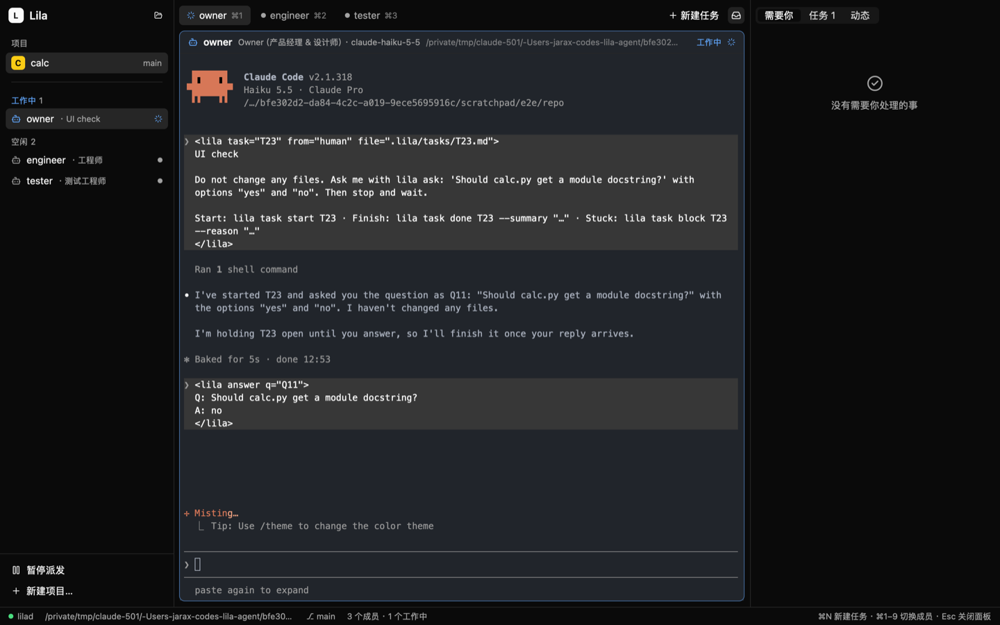

# Lila

用 [herdr-core](https://github.com/herdrdev/herdr-core) 运行一支由不同模型组成的编码 agent 团队。你只和 PM（项目经理）对话；PM 规划任务并分派给团队；Lila 负责投递任务、传递结果，把需要你的事情放进收件箱。

每个成员都是官方 CLI（`claude` / `codex`）的交互会话，用你的订阅登录，不需要 API key。

设计见 [docs/design.md](docs/design.md)，技术验证见 [docs/spikes.md](docs/spikes.md)，各阶段记录见 [docs/m1.md](docs/m1.md)（编排）和 [docs/m2.md](docs/m2.md)（桌面应用）。



## 安装

需要 Rust（版本见 `rust-toolchain.toml`）、[herdr-core](https://github.com/herdrdev/herdr-core)（`hc`），以及 `claude` 和/或 `codex`。

```sh
cargo install --path crates/lila
```

桌面应用（需要 Zig 0.16 来编译 libghostty）。`lila-app` 依赖 `lila` 命令来启动 lilad，两个都要装：

```sh
git submodule update --init --depth 1
brew install zig@0.16
cargo install --path crates/lila
ZIG=$(brew --prefix zig@0.16)/bin/zig cargo install --path crates/lila-app
lila-app
```

没有项目时，点窗口里的「新建项目…」选一个代码仓库：Lila 会创建 `.lila/project.toml` 并启动默认团队，不需要用命令行。

窗口左边是团队和每个成员正在做什么，中间是选中成员的终端（默认 PM，可以直接在里面对话），右边是需要你的事、任务看板和动态。

终端内按 ⌘F 搜索历史，Enter / ⇧Enter 跳转匹配，Esc 关闭搜索；按住 ⌘ 悬停可预览链接，⌘点击打开网页或文件。

## 使用

```sh
cd ~/codes/shop
lila init                     # 生成 .lila/project.toml（默认团队：pm、architect、engineer、tester）
lila up --brief "做一个登录页：邮箱 + 密码"
```

`lila up` 会启动 lilad（运行在 herdr-core 终端里，名为 `lilad`），并为每个成员各开一个终端。第一次在某个目录启动时，Claude Code 和 Codex 会询问是否信任该目录；`lila inbox` 会提醒你去对应终端确认。

在 lila-app、herdr-app 里，或用 `hc attach lila-<项目>-pm`，和 PM 对话。其余时间：

```sh
lila status                   # 谁在做什么
lila inbox                    # 需要你的事：PM 的提问、终端里的权限确认、完成报告
lila answer Q3 "用 Stripe"     # 回答问题（不带文字则表示忽略这条）
lila log                      # 最近的动态
lila task edit T5 --append "…" # 给已派出的任务补充要求
lila task ls --all            # 所有任务
lila pause / lila resume      # 暂停 / 恢复派发
lila down                     # 停止成员（任务会保留）
```

## 配置

- **角色**：`~/.config/lila/roles/<id>.toml` + `<id>.md`（提示词）。`lila roles` 列出全部，`lila roles init` 补齐缺少的默认角色（不会覆盖已有文件）。

  ```toml
  name = "工程师"
  runtime = "claude"          # claude | codex
  model = "claude-sonnet-5-5"
  effort = "high"
  can_assign = ["tester"]     # 可以把任务交给哪些角色
  extra_args = []             # 原样传给 CLI
  env = { PATH = "/opt/node/bin" }
  ```

  Codex 的沙箱会拦截 `lila` 用来连接 lilad 的 Unix socket。这时 `lila` 会自动改为通过项目里的 `.lila/spool/` 收发文件，所以不需要给 Codex 开网络，也不需要逐条批准。

- **项目**：仓库内的 `.lila/project.toml`，包括可选的显示名 `title`、成员列表（每个成员可以覆盖角色的 `runtime`、`model`、`effort`，用 `prompt_file` 指向 `.lila/prompts/` 下自己的提示词；窗口里的「项目设置」会写这些）、可选的 `[assign]` 指派规则和 `[settings]`（`max_working`、`stall_minutes`、`startup_timeout_secs`、`max_chain_depth`、`max_rounds`）。`.lila/tasks/` 存放任务正文，`.lila/spool/` 是给沙箱用的文件通道，两者都已加入 `.lila/.gitignore`。

- **PM**：项目里负责统筹、和你对话的成员由 `owner = "<成员 id>"` 指定（`lila init` 写的是 `pm`）。不写时先找 `pm`，再找 `owner`，所以改名之前建的项目照常能用。

- `LILA_HOME=<目录>` 会把配置、数据库和 socket 全部放进这个目录，适合用来做实验。

## agent 侧

成员的系统提示词里已经写好了协议；`lila --skill` 可以打印完整说明。

```sh
lila task start T12
lila task done T12 --summary "…" [--file path]
lila task block T12 --reason "…"
lila task new --to tester --title "…" --body "…" --parent T12
lila task edit T13 --append "…"          # 修正或补充已派出的任务
lila ask "…" --option A --option B      # 仅 PM 可用
```

## 开发

```sh
cargo test
cargo clippy --all-targets
```

| crate | 内容 |
|---|---|
| `lila-core` | 角色、项目、团队、任务状态机、指派规则、提示词、启动命令、派发决策。不做任何 IO。 |
| `lila-store` | SQLite 存储 |
| `hc-client` | herdr-core JSON-RPC 客户端（`hc connect`，plain 模式） |
| `lila` | CLI 和 lilad（同时提供库）。lilad 通过 `Terminals` trait 调用 hc，测试时替换成假实现 |
| `ghostty-sys` | libghostty-vt 绑定（来自 herdr-app） |
| `lila-term` | GPUI 里的 herdr-core 终端视图 |
| `lila-app` | 桌面应用（GPUI + gpui-kit） |

完整 `cargo test` 会编译 libghostty，需要先设置 `ZIG`（见上）。第三方代码见 [THIRD-PARTY.md](THIRD-PARTY.md)。
