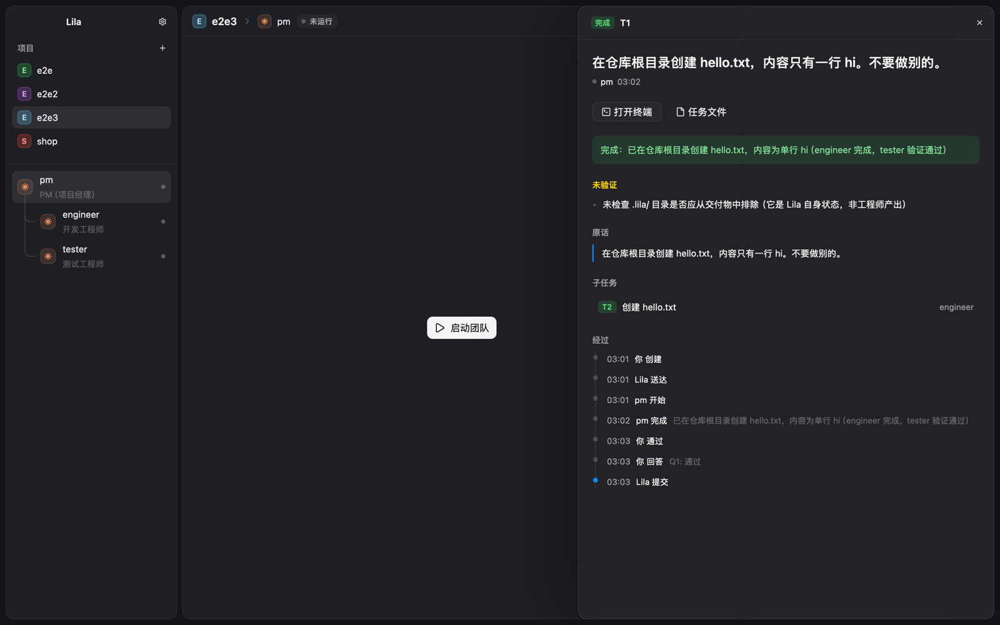

# Lila

一个有自己界面的 agent，自己的 harness，跑在 oh-my-pi（omp）上。在工作区（一个文件夹）里开会话，omp 干活，Lila 提供界面、权限、检查点和改动。模型和登录是 omp 自己的配置。



## 安装

需要 Rust（版本见 `rust-toolchain.toml`）、[herdr-core](https://github.com/herdrdev/herdr-core) 的 `hc`（lilad 和每个会话的 omp 都跑在它的终端里），以及 `omp`（已经登录、配好模型）。

```sh
cargo install --path crates/lila
cargo install --path crates/lila-app
lila-app
```

`lila-app` 用 `lila` 命令启动后台的 lilad，两个都要装。

## 使用

Lila 是一个有自己界面的 agent：在工作区（一个文件夹）里开会话，会话由 omp 跑，Lila 提供界面和权限。

- **新建工作区**：侧栏「工作区」旁的文件夹加号，选一个文件夹。
- **新会话**：⌘N，或侧栏的「新会话」、鼠标停在工作区行上出现的 `+`。直接出现输入框，光标已经在里面；发出第一条消息时才真正创建会话。发出之前可以在输入框下面改权限档，默认值是工作区默认值。
- **侧栏**（⌘B 收起或展开）：每个工作区下是它的会话。转圈是在工作，红点是在等你（要你允许一个操作），灰字是已结束，其余是空闲。右键一个会话：重命名、结束或继续、归档。归档的会话默认不显示，在工作区上右键选「显示已归档」列出来，再右键会话取消归档。
- **对话**：消息、思考、工具调用，底下是输入框。权限确认以卡片出现在对话里，在卡片上选。标题行右边：文件、改动、在访达中显示；已结束的会话有「继续」。从 Claude Code、Codex 时代留下的会话还能看对话，不能继续。
- **权限档**：每个会话三档，随时切换：只读、改动前确认、全自动（默认）。全自动下，改工作区以外的文件、`git push`、对外发出的动作仍然会问。
- **工作区设置**：⇧⌘,（或工作区右键「工作区设置…」），设名称、新会话的默认模型（从 omp 列出的里选）和权限档，存在工作区的 `.lila/project.toml`（模型是 omp 认得的 `provider/model`）。⌘, 是全局设置：关于。
- **通知**：窗口不在前面时，会话开始等你、或一轮跑完，发系统通知。

| 快捷键 | |
|---|---|
| ⌘N | 新会话（在当前工作区里） |
| ⌘B | 收起或展开侧栏 |
| ⌘1–9 | 切到第 n 个工作区的最近会话（没有会话就是它的新会话） |
| ⌘. | 中断正在跑的这一轮 |
| ⌘, / ⇧⌘, | 全局设置 / 工作区设置 |
| ↩ / ⇧↩ | 发送 / 换行（输入框里） |
| Esc | 关闭对话框 |

输入框里：`@` 选工作区里的文件，`/` 选命令和 skill（omp 声明的），`+` 菜单、拖进来或粘贴来添加附件；框是空的时候 ↑ 取回上一条话。

## 命令行

窗口能做的，命令行都能做，走同一个 socket：

```sh
lila up                                  # 启动 lilad，把当前文件夹加成工作区
lila thread new "做一个登录页" --model deepseek/deepseek-v4
lila thread list
lila thread show t07b6b991               # 对话和待答的权限卡片
lila thread send t07b6b991 "再加个测试"
lila thread answer t07b6b991 p1 allow
lila thread stop t07b6b991 / resume t07b6b991
lila thread permission t07b6b991 confirm
lila project set --model deepseek/deepseek-v4 --permission full
```

## 配置

- **工作区**（代码和文件里叫 project）：`.lila/project.toml`，里面是工作区的 id、标题和新会话的默认值（模型、权限档）。
- `LILA_HOME=<目录>` 把配置、数据库和 socket 都放进这个目录。

## 开发

```sh
cargo test --workspace
cargo clippy --workspace --all-targets
```

| crate | |
|---|---|
| `lila-core` | 权限档、会话、项目默认值、omp 的启动参数。不做 IO。 |
| `lila-store` | SQLite |
| `lila` | CLI 和 lilad |
| `lila-agent` | 对话事件模型和 omp RPC 模式的翻译（纯函数） |
| `hc-client` | herdr-core 客户端 |
| `lila-app` | 桌面应用（GPUI） |

架构见 [docs/architecture.md](docs/architecture.md)，开发计划见 [docs/plan.md](docs/plan.md)，界面规范见 [DESIGN.md](DESIGN.md)，截图自查和真 omp 的跑法见 [docs/development.md](docs/development.md)。第三方代码见 [THIRD-PARTY.md](THIRD-PARTY.md)。

## 参考

- https://code.claude.com/docs/en/sub-agents
- https://x.com/DeepSeekHarness/status/2116857257245987236
- https://x.com/trq212/status/2061907337154367865
- https://x.com/addyosmani/status/2117512471930167377
