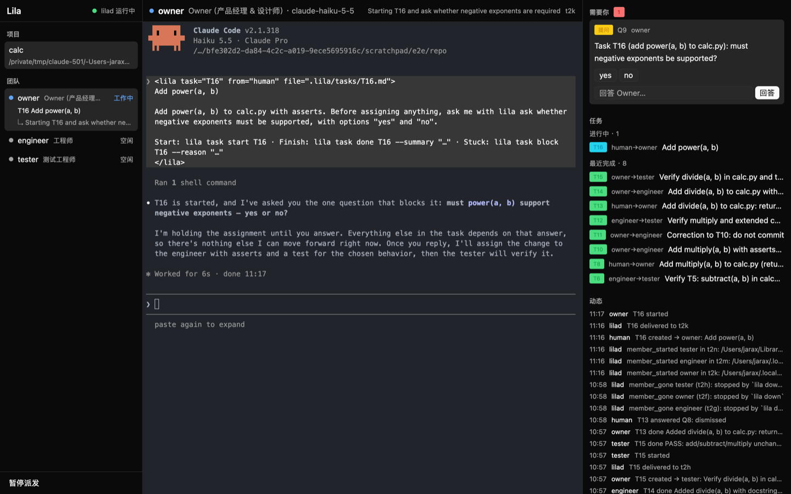
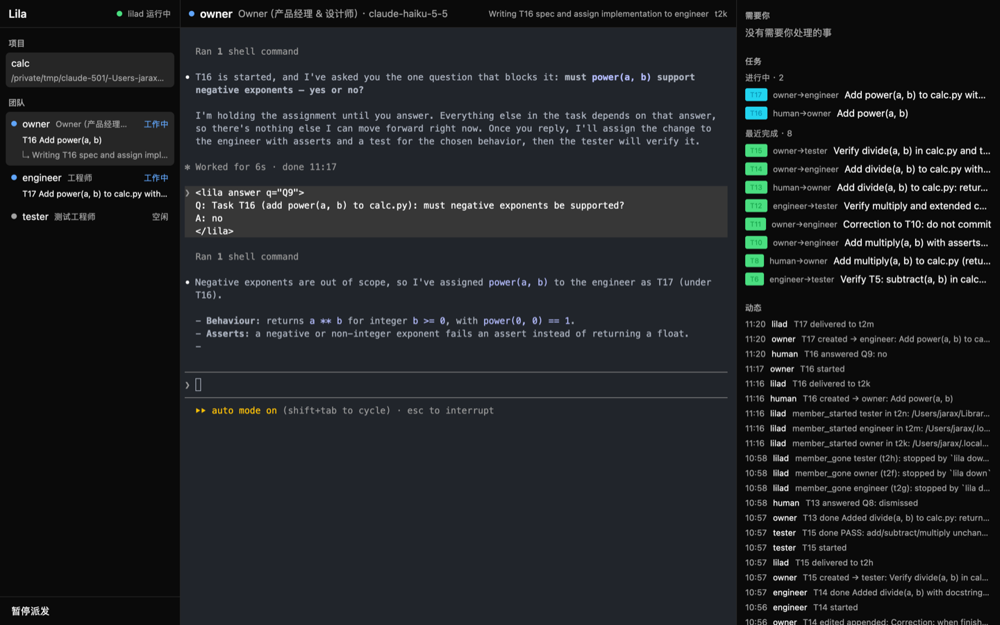
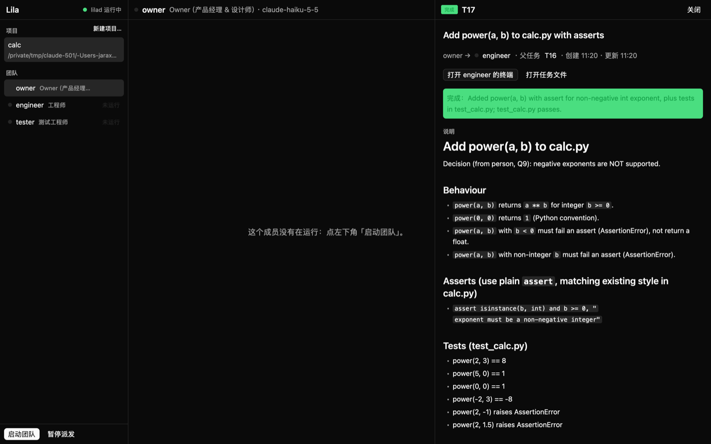
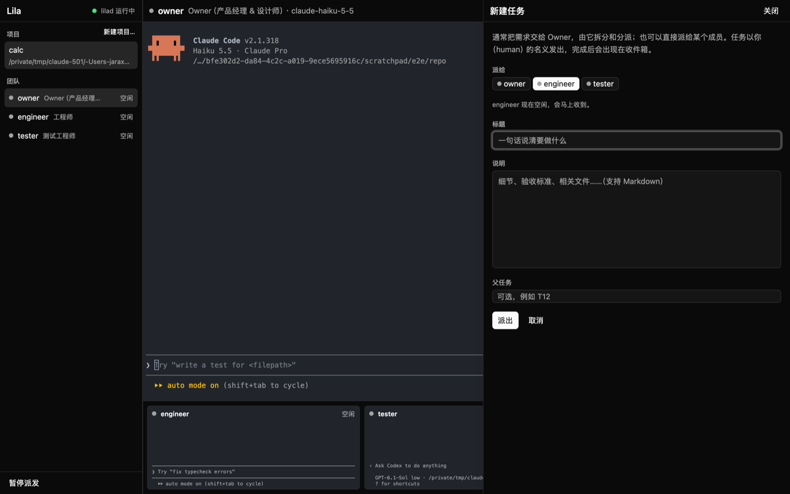
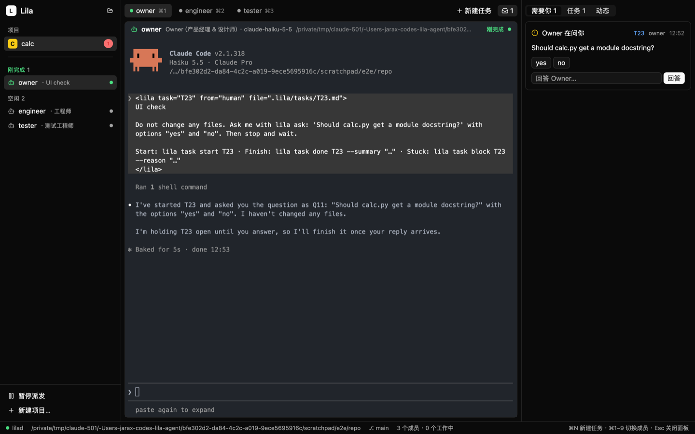
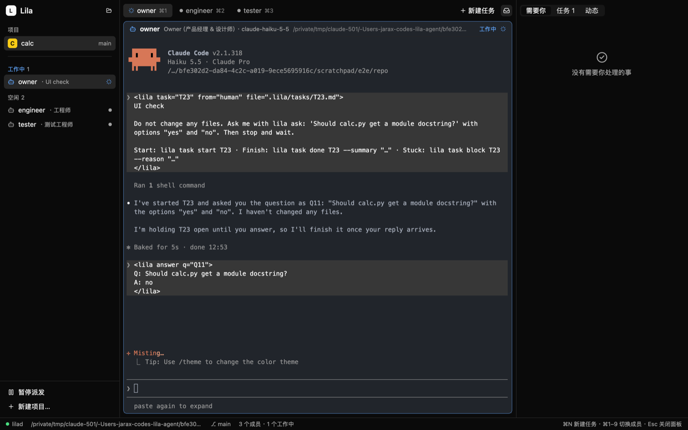
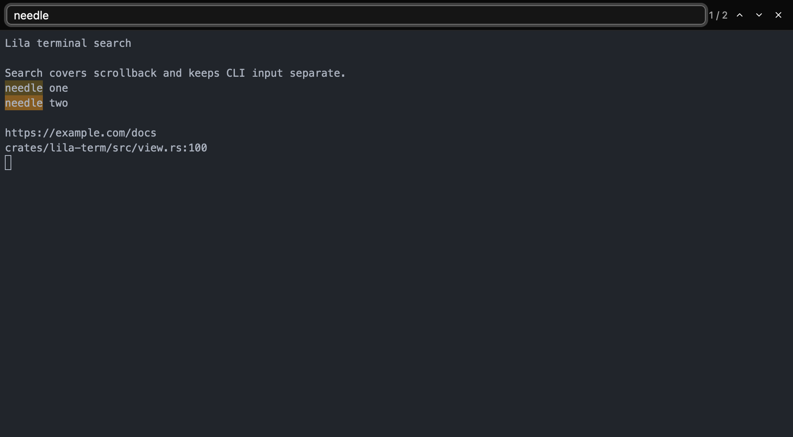

# M2 记录：桌面应用 lila-app

> 2026-11-05 · Rust + GPUI（通过 gpui-kit 0.9）+ libghostty + herdr-core





## 技术选型：采用 gpui-kit

| | 选项 | 结论 |
|---|---|---|
| UI 组件 | 照 herdr-app 自己写，或用 [gpui-kit](https://github.com/longbridge/gpui-kit) | **用 gpui-kit 0.9**：Button、Input（支持 IME）、Tag、滚动条、主题这些直接可用。后续要用的分栏（resizable / dock）、表格、Markdown、通知也都有 |
| GPUI 版本 | herdr-app 的补丁版 `gpui-pre 0.3.8`，或 gpui-kit 固定的 `gpui-pre 0.3.11` | **跟 gpui-kit 用 0.3.11（crates.io 原版）**。herdr-app 的补丁修的是 macOS 窗口空闲时每帧唤醒等问题；实测空闲 CPU 约 0.4%，暂时不需要 |
| 终端 | 在 M0 的 spike 基础上写，或移植 herdr-app | **移植**：`vt.rs`、`hc.rs`、`sprites.rs`、`links.rs`、`win32_keys.rs` 从 herdr-app 搬过来（Apache-2.0，文件头注明出处），视图层 `view.rs` 自己写，按键编码、IME、行绘制照 herdr 的做法 |

gpui-kit 用 `gpui = { package = "gpui-kit" }` 的方式引入，这样移植来的代码里 `use gpui::…` 不用改。

## 新增的 crate

| crate | 内容 |
|---|---|
| `ghostty-sys` | 原样复制自 herdr-app：用 Zig 编译 `vendor/ghostty`（git 子模块，固定在 herdr-app 使用的 `291fd05`）里的 libghostty-vt，并用 bindgen 生成绑定 |
| `lila-term` | 一个可接入 herdr-core 终端的 GPUI 视图：framed attach、流量控制（credit）、libghostty 解析、按 style 合并的行绘制、方框线、光标、输入法组字、键盘（libghostty 按程序请求的模式编码）、Cmd+V 粘贴（bracketed paste）、拖动选择 + Cmd+C、滚轮（备用屏幕下发方向键）、只读 observe 模式 |
| `lila-app` | 主窗口（见下） |
| `lila`（改动） | 增加 `[lib]`，app 复用它的 socket 客户端和路径逻辑 |

## 界面

- **左栏**：
  - lilad 状态。
  - 项目列表：直接读 SQLite，所以 lilad 没运行时也能显示。
  - 成员列表：状态点和中文状态（工作中 / 等你 / 刚完成 / 空闲 / 未运行）、当前任务、7501 `msg`（"↳ 正在做什么"）、排队数。点击切换中间显示的终端。
  - 底部的「启动团队」（有成员未运行时出现）和「暂停/恢复派发」。
- **中间**：选中成员的完整可交互终端，默认是 Owner。标题栏显示角色、模型、`msg` 和终端地址。成员重启后自动重新附着。
- **右栏**：
  - **需要你**：卡片按类型显示（提问 / 终端等你 / 启动卡住 / 没有回应 / 成员退出 / 完成报告）。提问可以点选项按钮，也可以在输入框里自由回答；其他类型有「打开终端」和「知道了」。
  - **任务**：进行中、阻塞、排队、最近完成。
  - **动态**：最近 30 条事件。
- 数据每秒向 lilad 拉一次（`status`、`task.ls`、`inbox`、`log`），所有请求都在后台线程执行。

## 实测

用 M1 的 calc 测试项目（Haiku + Codex low）跑了一轮：

1. 在界面里看到 Owner 收到 T16 → 用 `lila ask` 提问 → 收件箱出现带「yes / no」按钮的卡片，左栏 Owner 显示"工作中 · ↳ Starting T16 and ask whether…"。
2. 回答后：卡片消失，Owner 终端里出现 `<lila answer>`，engineer 变成"工作中"，看板出现 T17。
3. 结束时：所有成员"刚完成"，收件箱出现完成报告。
4. 修复了 1 个 bug：附着时窗口还没布局，PTY 停在默认的 100×30，Claude Code 只用了上 2/3 的高度 → 附着成功后按实际网格尺寸补发一次 resize（修复后 PTY 是 100×45，占满）。

空闲时 CPU 约 0.4%，RSS 约 140 MB（debug 构建，含每秒轮询）。

**需要你亲手验证的**：
- 在界面里点收件箱的选项按钮，以及在输入框里回答。
- 在 Owner 终端里用中文输入法打字（组字预览和上屏）。
- 拖动选择后按 Cmd+C 复制，Cmd+V 粘贴。

这三项我这边没有办法操作 GUI，所以没有验证。

## 构建与运行

```sh
git submodule update --init --depth 1          # vendor/ghostty
brew install zig@0.16
export ZIG=$(brew --prefix zig@0.16)/bin/zig
cargo run -p lila-app                          # 首次编译 libghostty 需要几分钟
```

开发时可以加 `--features shots`，再设置 `LILA_APP_SHOT=/path/x.png`：窗口每 2 秒会把自己保存成一张 PNG，不需要屏幕录制权限。这个特性会打开 GPUI 的 `test-support`，只用于开发。

## 任务详情面板



**打开方式**：点击以下任意位置的任务编号，右侧就会盖上一个 560px 宽的面板。按 Esc 或点「关闭」可以关掉它。
- 看板里的任务行
- 左栏成员下面的当前任务
- 动态里的任务编号
- 收件箱卡片上的任务编号
- 面板里的父任务和子任务

**面板内容**：
- 状态和标题
- 派发人 → 执行人，执行人前面有状态点
- 父任务（可以点击）
- 创建和更新时间
- 完成总结或阻塞原因，用彩色左边框标出
- 正文，用 gpui-kit 的 `TextView::markdown` 渲染
- 交付文件，点击后用系统默认应用打开
- 交出去的子任务，带状态
- 完整的事件时间线

**面板操作**：
- 「打开 X 的终端」
- 「打开任务文件」
- 「取消任务」：要点两下，第一次会变成「确认取消 / 算了」
- 「追加说明」：调用 `task.edit --append`。提示文字会按状态说明效果：还在排队就直接写进任务；已经送达就作为更新发给执行人。

面板的数据跟着每秒的轮询一起刷新：轮询时会顺带请求这个任务的 `task.show`。打开时会立刻先拉一次，所以不会有一秒的空白。

不用鼠标也能检查：开发时用 `--features shots`，再设置 `LILA_APP_OPEN_TASK=T16`，窗口启动后会直接打开这个任务。我用它截了已完成任务（含子任务和 Markdown 正文）和排队任务（含追加说明、取消按钮）的界面，都确认过了。

## lilad 推送变化

lilad 每处理完一个输入（CLI 请求、hc 事件、定时器、spool），就比较一次"指纹"：SQLite 连接的 `total_changes`，加上成员实时状态（状态、kind、msg、终端）的版本号。指纹变了，就向所有订阅者推送 `{"event":"changed","seq":N}`。只读请求不会让指纹变化。

在 socket 上发 `subscribe`，这条连接就会变成事件流；客户端用 `lila::client::subscribe` 读取。lila-app 用一个后台线程订阅，lilad 不在时每秒重连。收到通知后等 80ms 合并一波再刷新，兜底轮询从 1 秒改为 5 秒。

实测：`lila task new` 之后 95ms，界面就出现了新任务。两次变化之间没有多余的刷新。设置 `LILA_APP_DEBUG=1` 会打印每次刷新。

## 可调整的布局

三栏改用 gpui-kit 的 `h_resizable`。左栏（200–460px）和右栏（300–720px）是 `fixed`，窗口缩放时保持你拖出来的宽度。

成员缩略图做过一版（屏幕最后几行文字），按你的意见去掉了，现在切换成员靠左栏。

## 在界面里新建和改写任务



**新建任务**：
- 入口：右栏"任务"标题旁的「新建任务…」，或者详情面板里的「派子任务」（会预填执行人和父任务）。
- 表单：派给（按钮选择成员，带状态点）、标题、说明（多行，支持 Markdown）、父任务（可选）。
- 选中成员后，下面会提示任务什么时候送达：马上、排在后面、还是等团队启动。
- 任务以 human 的名义发出（你可以派给任何人），完成后出现在收件箱。
- 派出后自动打开这个新任务的详情。出错时，错误显示在表单里。

**改写排队中的任务**：详情面板里有「改写」按钮，只对还在排队的任务显示。点开后可以直接修改标题和说明，保存时调用 `task.edit --title/--body`。已经送达的任务仍然只能追加说明。

开发时设置 `LILA_APP_COMPOSE=<成员>`（需要 `--features shots`），启动后会直接打开新建任务表单。表单截图确认过；「派出」「保存」需要鼠标点，这两步还没在界面里点过，但它们调用的 `task.new` 和 `task.edit` 已经有单元测试和 CLI 实测覆盖。

## 界面重构（参考 Herdr 的设计语言）





代码结构上，`app.rs` 只保留状态和动作，渲染挪到了 `ui.rs`。详情面板和新建任务面板仍在 `detail.rs` 和 `compose.rs` 里。

- **侧栏**：
  - 窗口底色是较深的 chrome 色，内容区是较浅的卡片色，分隔线对比度很低。
  - 顶部是红绿灯、Lila 标志和"新建项目"图标按钮。
  - 项目列表列出所有项目：头像、名字（设置里的项目名称，没有就用编号）、团队状态或 git 分支、待处理数。点一下就在顶部打开它的标签。
  - 成员按状态分组，顺序是 等你 → 工作中 → 刚完成 → 空闲 → 启动中 → 未运行，每组标题带颜色和数量。
  - 成员行：机器人图标、名字、"· 正在做什么"（7501 msg，没有就显示当前任务标题，再没有就显示角色名）、排队数，工作中时显示转圈。
  - 底部是带图标的操作项：启动团队、暂停/恢复派发。
- **中间**：
  - 顶部只显示打开的项目标签：头像、名字、团队状态（有人工作中显示转圈，有人等你显示红点，取自该项目最近一次的数据）、待处理数或 ⌘1–9 提示、关闭按钮。关闭标签不会停掉团队。打开的标签记在 `<state>/app-tabs.json`，下次启动时恢复。右侧是「+ 新建任务」、项目设置和面板展开按钮。
  - 成员的设置改过、但还在用旧设置运行时，侧栏成员行显示「待重启」，终端卡片标题行有「重启」按钮（`member.restart`：当前对话会丢失，手上的任务回到队列再派给它）。
  - 切换项目时立即拉取新数据，期间先显示该项目上次的快照。
  - 终端放进圆角卡片。卡片标题行：图标、名字、角色 · 模型、路径、正在做什么、状态和转圈。
  - 卡片边框跟着状态变：工作中是蓝色，等你是红色。
  - 出错提示改成卡片上方的一条横幅，可以关掉。
- **右侧面板**：
  - 标题「概览」，右上角收起按钮。下面纵向排列「需要你 n」「任务 n」「动态」三段，整体滚动。
  - 有新事项进来时，面板会自动打开。
  - 收件箱卡片按类型显示图标和颜色。任务按"进行中 / 阻塞 / 排队 / 最近完成"分组，每行两行字：编号、标题，以及谁→谁 · 时间。
- **状态栏**：lilad 状态、项目路径（`~` 缩写）、分支、成员数和工作中数、等你的数量、是否暂停，右侧是快捷键提示。
- **红绿灯**：位置 `(12, 14)`，侧栏标志从 84px 开始。lila-app 的 `build.rs` 让链接器把 SDK 版本记成 15.5。用新 SDK（如 27.x）链接时，AppKit 会换成更大、间距更宽的新版按钮，和 Herdr（15.5 SDK 构建）不一致。
- **项目设置**（⌘, 或标签栏的齿轮；M3 起改为对话框，入口是项目右键菜单和 ⇧⌘,，见 `m3.md`）：项目名称，以及每个成员的运行方式（Claude Code / Codex）、模型（常用的几个可直接点选，也可以手填）、努力程度、预设提示词（默认是角色的提示词，可恢复）。由 `lila::settings` 保存：只把和角色不同的值写进 `.lila/project.toml` 对应的 `[[members]]`（`runtime`、`model`、`effort`、`prompt_file`），注释和排版保留；成员自己的提示词存为 `.lila/prompts/<id>.md`。保存后调用 `project.reload`，lilad 重新读取配置。
- **快捷键**：⌘N 新建任务、⌘1–9 切换标签、⌘W 关闭标签、⌘, 项目设置（M3 起是全局设置）、⌘I 显示或隐藏右侧面板、Esc 关闭详情或表单。终端负责 ⌘C、⌘V 和搜索快捷键，其余 ⌘ 组合键交给窗口处理。
- **图标**：gpui-kit 自带的 Lucide 图标，需要 `application().with_assets(Assets)` 注册，否则不显示（第一次截图时就是空的）。

## 待办

- Option 作为 Alt 键（herdr-app 的这部分依赖它打过补丁的 gpui_macos）、kitty 图片。
- 角色库编辑器、新建项目向导（设计 §10.2，放在 M3）。项目设置的增删成员、指派规则、`[settings]` 已在 M3 补上，见 `m3.md`。

## 接手复核（2026-11-05）

- `cargo test --workspace`：114 个测试通过。
- `cargo clippy --workspace --all-targets -- -D warnings` 和 `cargo clippy -p lila-app --features shots -- -D warnings`：均通过。
- `cargo build -p lila-app --features shots`：通过。在临时 `LILA_HOME` 中放入两个未启动团队的测试项目，窗口截图确认项目列表、标签和 lilad 未运行时的界面正常。
- 用 `LILA_APP_SWITCH` 切换两个项目，确认触发立即刷新，`app-tabs.json` 保存两个打开的标签及当前项目。本次只验证了 lilad 未运行的情况，没有启动模型 CLI，也没有修改已有项目。
- 当前界面工具未能识别直接运行的 `target/debug/lila-app`，因此这次仍未验证真实鼠标、键盘及输入法交互；上文的人工验证项保留。

## 终端搜索与链接（2026-11-05）



- **搜索**：点击终端标题行的放大镜或按 ⌘F，搜索当前终端及其滚动历史，默认忽略大小写。显示匹配数量，并高亮可见的匹配；Enter / ⌘G 跳到下一处，⇧Enter / ⇧⌘G 跳到上一处，首尾循环。Esc 或关闭按钮收起搜索栏并把焦点交回终端。再次按 ⌘F 会选中已有关键词，方便替换；每个终端分别保留自己的关键词。
- **持续更新**：查询、终端输出和尺寸变化后都分步推进搜索，索引完成后停止调度。搜索输入不会写进成员 CLI，搜索定位也不替换用于复制的文本选择。
- **链接**：按住 ⌘ 悬停时显示下划线、手形光标和目标预览，⌘点击后交给系统默认应用打开。支持普通 URL、OSC 8 超链接，以及确实存在的文件路径（含 `:行号:列号` 后缀）；相对文件路径按项目工作目录解析，打开文件时去掉行列号。普通点击和拖动继续用于文本选择，⌘拖动不打开链接。
- **验证**：工作区 118 个测试通过，普通和 `shots` 两组 Clippy 均零警告。新增的视图测试使用 GPUI 的真实输入分发和假传输，覆盖搜索快捷键、输入隔离、输出和尺寸变化、关闭后的终端输入、链接悬停和选择；路径解析另有测试。截图来自只运行 shell 的临时 hc 终端，没有启动模型 CLI。系统浏览器/文件应用的最终打开和真实输入法仍需人工验证。
