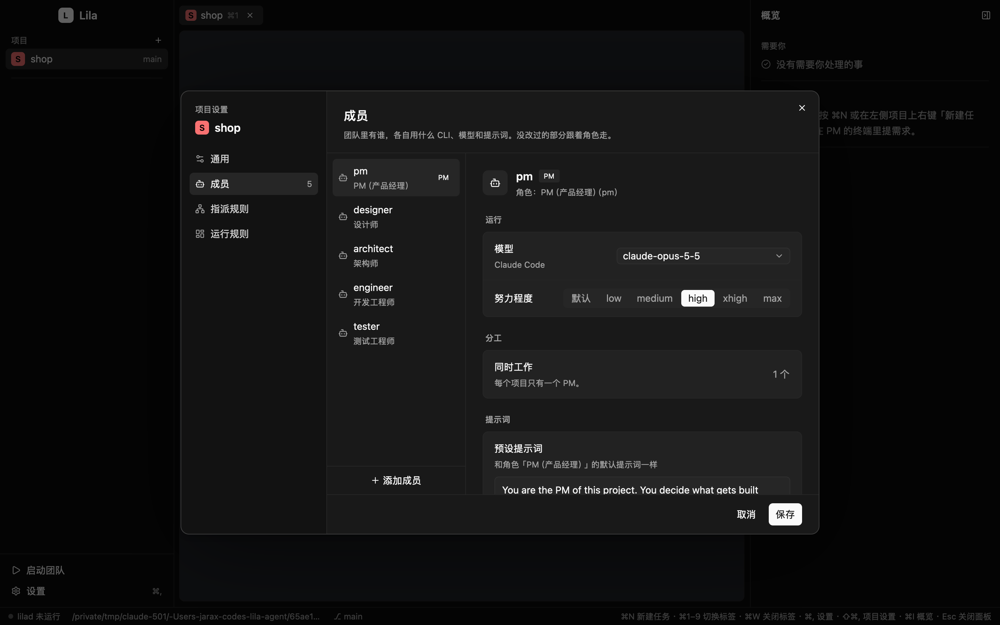
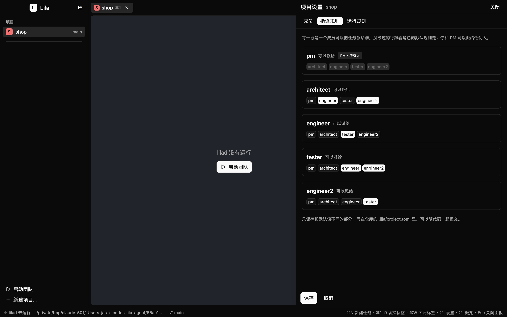
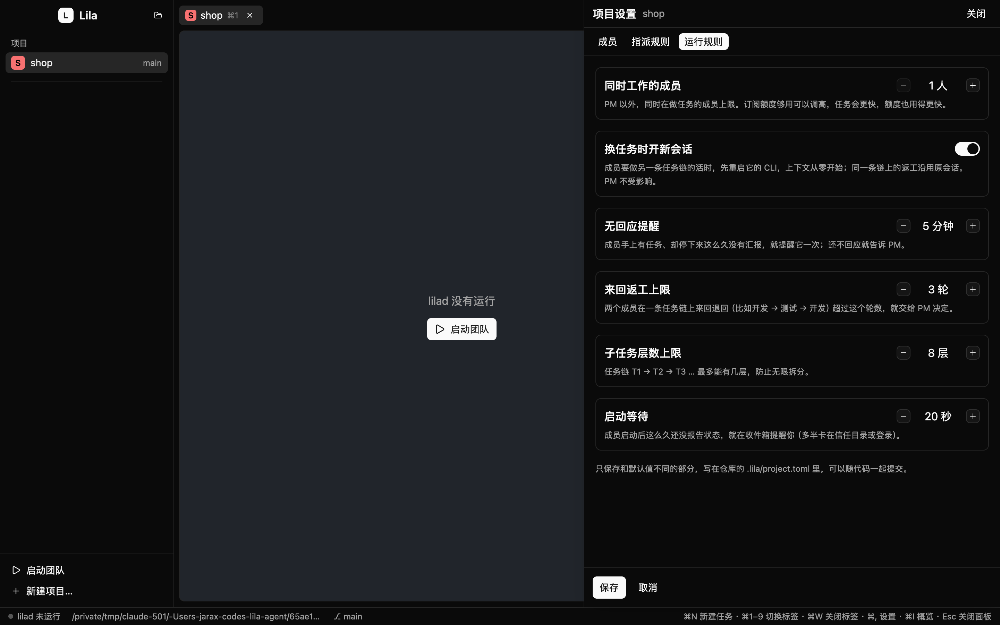
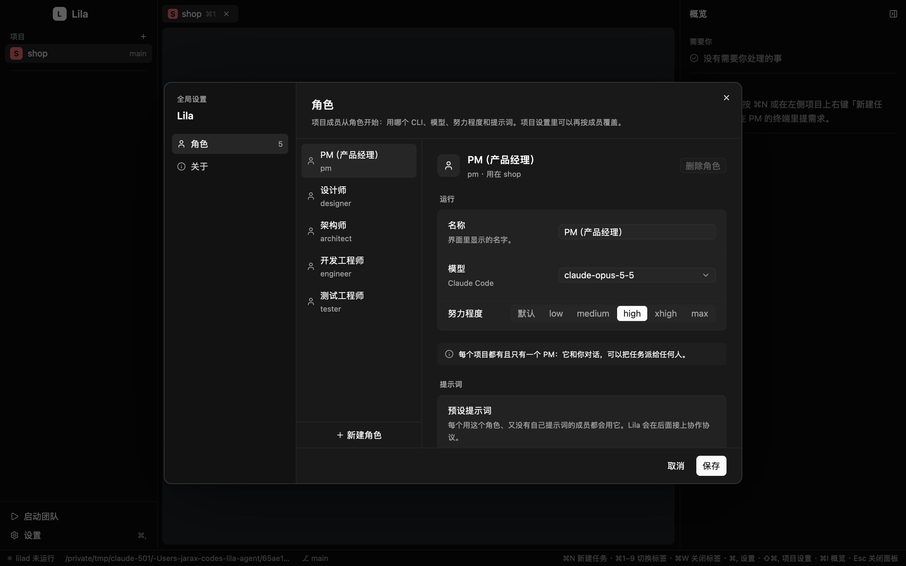
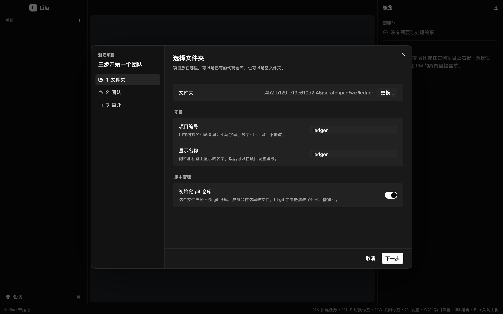
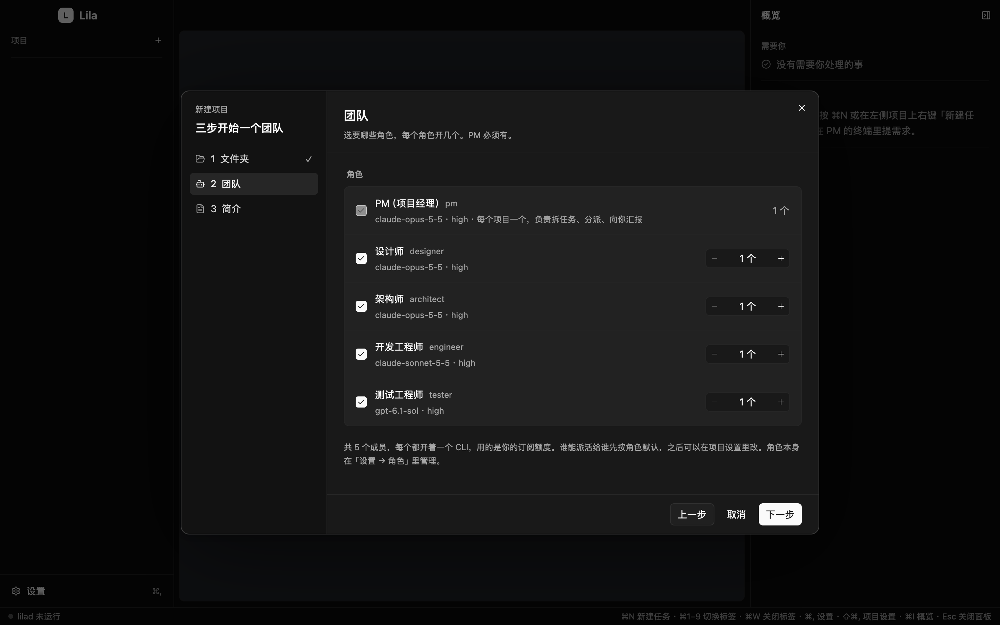
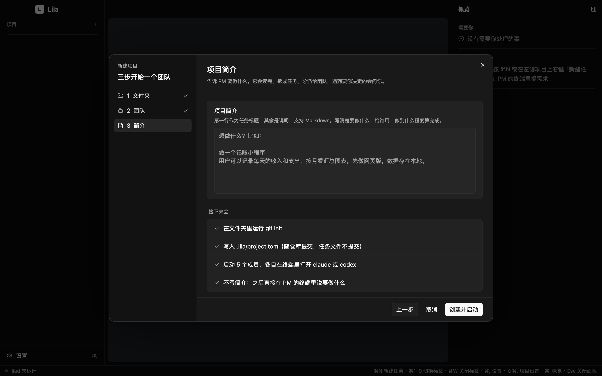
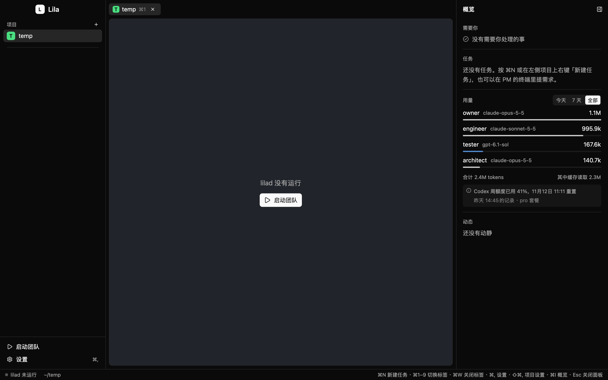

# M3 记录：增强

> 2026-11-05 起 · 分支 `m3`（叠在 `m2-gui` 上）

设计 §12 里 M3 写的是"按需排序"。我排的顺序如下，理由是先解决已经观察到的问题，再做界面，最后做改动面大、需要你拍板的部分：

| 顺序 | 内容 | 状态 |
|---|---|---|
| 1 | **换任务时开新会话**：解决长期在线成员的上下文膨胀（M1 发现 4） | ✅ 见下 |
| 2 | **项目设置补全**：增删成员、指派规则、`[settings]` | ✅ 见下 |
| 3 | **新建项目向导**：选目录 → 选角色 → 写简介 → 启动（设计 §10.2） | ✅ 见「新建项目向导」一节 |
| 4 | **角色库编辑器**：编辑全局角色 | ✅ 放进了全局设置，见「界面调整」一节（还没有「预览最终提示词」） |
| 5 | **用量统计**：读 Claude Code / Codex 自己写在本机的会话记录，按成员汇总 token | ✅ 见「用量统计」一节 |
| 6 | **每成员独立 git worktree**：要先和你确定合并方式 | 待定 |
| 7 | **远程机器**（hc machine） | 待定 |

## 1. 换任务时开新会话

成员一直开着同一个 CLI 会话，做过的任务越多，上下文越大。现在 lilad 在派任务前做一次判断：

- 每个任务都属于一条**链**，链的根是没有父任务的那个任务（T1 → T4 → T9 的链根是 T1）。
- lilad 记住每个成员这个会话里最后拿到的任务属于哪条链。
- 新任务和上一个任务**同一条链**（比如 tester 退回的返工），沿用原会话，成员还记得自己做过什么。
- 新任务来自**另一条链**，lilad 先杀掉成员的 CLI 再重新启动，等新会话报告 idle 后再送达任务。任务本身带着完整说明（标题、正文、任务文件），不依赖旧上下文。
- **PM 永远不重启**，因为它在和你对话。
- 如果成员还有一条刚打进去的通知没读完（比如"T1 已经由 tester 验证通过"），先等它读完、再次 idle 后才重启。
- 计划内的重启不会在收件箱里报警，动态里会记一条 `fresh_session`。窗口会自动重新附着到新终端。

配置在 `.lila/project.toml` 的 `[settings]` 里，默认开启：

```toml
[settings]
fresh_session = true   # false 则所有成员一直沿用同一个会话
```

**已知限制**：lilad 只在内存里记住"上一条链"。lilad 重启之后，每个成员拿到的第一个任务不会触发重启。

**验证**：新增 3 个 daemon 测试（另一条链会重启、同链不重启、PM 不重启、可关闭、有未读通知时推迟），`cargo test -p lila` 39 个全部通过。重启沿用 `member.restart` 的杀掉 + 启动路径。没有真跑模型 CLI。

## 2. 项目设置补全







项目设置是一个居中的对话框（在项目上右键 →「项目设置…」，或 ⇧⌘,），左边导航分四页：

- **通用**：项目名称；项目编号、目录、配置文件只读显示。
- **成员**：左边是成员列表（PM、新成员、改过的会标出来），右边编辑选中的成员。
  - 运行方式和努力程度用分段控件；模型是输入框，旁边的下拉菜单列出这个 CLI 的常用模型。和角色默认不同时，下面会写出角色默认值。
  - 「移出团队」在成员标题右边，PM 没有这个按钮。
  - 列表底部「添加成员」弹出角色菜单。编号默认用角色名，被占用就是 `engineer2`、`engineer3`……新成员的编号可以改。新成员保存后不会自动启动，要点侧栏的「启动团队」。
- **指派规则**：一张勾选表，行是派活的人，列是接活的人。
  - 没改过的行跟着角色的 `can_assign` 走，比如新加的 engineer2 会自动出现在 tester 那一行。改过的行右边有「恢复默认」。
  - PM 那一行全部勾上且不能改。
- **运行规则**：分「派发 / 防失控 / 启动」三组。数字用 − / + 调，有上下限；「换任务时开新会话」是开关。

底部一栏会提示「有未保存的更改」、保存后会停掉哪些成员，或者保存出错的原因。

**保存时写什么**（`lila::settings::save`，仍然保留注释和排版）：
- 移出的成员：删掉它的 `[[members]]`，以及 `.lila/prompts/` 下它自己的提示词文件。
- 新成员：追加 `[[members]]`，只写 `id` 和 `role`，其他和角色不同的才写。
- `[assign]`：只写和角色默认不同的行；一行都没有就去掉整个表。
- `[settings]`：已经写在文件里的键照常更新，值前面的注释保留；没写过的键，只有不是默认值才加上。

**lilad 怎么处理移出的成员**：`project.reload`（保存时自动调用）重新读配置。配置里没有了、但数据库里还有记录或还有没做完任务的成员：
1. 停掉它的终端；
2. 取消它没做完的任务，派活的成员会收到一条通知，让它在需要时改派给别人；
3. PM 收到一条汇总，列出被取消的任务；
4. 收件箱里和它有关的提醒一并关掉，数据库里删掉它的成员记录。

lilad 当时没在运行也一样：下次启动读配置时会补做这一步，而且只做一次。保存前，面板底部会提示哪些正在运行的成员会被停掉。

**验证**：
- `lila::settings` 新增 4 个测试：增删成员、指派行只在不同时写、`[settings]` 保留注释、改名后规则跟着走。lilad 新增 2 个测试：重新读取时移除，以及 lilad 重启后补做移除。工作区 127 个测试通过，两组 Clippy 零警告。
- 截图用临时 `LILA_HOME` 和 `lila init` 生成的项目，每页都看过。开发钩子：`LILA_APP_SETTINGS=general|members|assign|rules` 打开指定页，`LILA_APP_SETTINGS_ADD=<角色>` 再加一个成员。
- 还要你亲手点一下：添加、移出、改编号，勾选表和 − / + 的点击，最后保存。

## 界面调整（按你的意见，2026-11-05）

- **新建项目**：侧栏「项目」小标题右边的 `+`。红绿灯那一行去掉了文件夹图标。
- **项目右键菜单**（侧栏的项目行和顶部标签都有）：新建任务…、项目设置…、在访达中显示、关闭标签。标签栏右边不再放「新建任务」和齿轮。⌘N 仍然是新建任务。
- **侧栏底部**：去掉「新建项目…」，加了「设置」，打开全局设置。
- **快捷键**：⌘, 打开全局设置，⇧⌘, 打开当前项目的设置。
- **设置改成对话框**：项目设置和全局设置都是居中的对话框，背景变暗，Esc、右上角 ✕ 或「取消」关闭。不再从右侧滑出抽屉。

### 全局设置



- **角色**（M3 第 4 项）：左边是角色列表，右边编辑：名称、运行方式、模型、努力程度、默认可以派给哪些角色（勾选）、预设提示词。
  - 「新建角色」以某个已有角色为模板复制一份，编号可以改。
  - 「删除角色」只对没有项目在用的角色可点，鼠标悬停会说明是哪些项目在用。
  - 保存由 `lila::roles::save` 写入 `~/.config/lila/roles/<id>.toml` 和 `.md`，保留注释，以及 `extra_args`、`env` 这些界面没有显示的键。保存后，对每个项目调用 `project.reload`，用这个角色、正在运行的成员会标「待重启」。
- **关于**：版本、lilad 是否在运行、项目数，以及角色、数据库、状态目录、socket 的位置。
- 开发钩子：`LILA_APP_PREFS=roles|about`。

**验证**：`lila::roles` 新增 2 个测试（改角色保留注释和其他键、新建和删除、在用的不能删；按角色统计项目），工作区 129 个测试通过，两组 Clippy 零警告。每个对话框页面都截图看过。右键菜单和下拉菜单要鼠标操作，这边没法点，需要你亲手试。

## 第二轮调整（2026-11-05）

- **对话框层次**：背景压暗到 62%；对话框表面和里面的卡片在深色主题下各亮一档，边框更亮，并加上两层阴影（大范围柔和的一层，贴边的一层）。
- **关闭按钮**固定在对话框右上角。
- **拖动**：按住对话框的标题区（右侧页面标题，或左侧导航顶部）拖动，可以移动对话框。每次打开都回到正中。
- **模型用 Select**：分成「Claude Code」「ChatGPT · Codex」两组，选哪一组的模型就用哪个 CLI 运行，所以「运行方式」不再单独设置。配置里已有、但不在列表里的模型，会放进它那个 CLI 的分组里。
- **预设角色**：PM（项目经理）、设计师、架构师、开发工程师、测试工程师。
  - 新增设计师：负责流程、各种界面状态、文案和交互，写进 `docs/`，然后交给开发工程师。PM 是项目经理：拆任务、分派、跟进、向你汇报，设计交给设计师。
  - `lila init` 的默认团队加上了 designer。
  - 已经装过的默认角色文件，只要没改过（和旧版内容完全一样），下次 `lila init` / `lila up` 时会升级成新版；改过的不动。旧版内容放在 `defaults/roles/previous/`。
  - PM 角色不能删除。项目里只能有一个 PM，「添加成员」菜单里不再出现 PM 角色。
- **同时工作改为按成员设置**：成员页「分工 → 同时工作」可以设置 1–9 个，对应 `[[members]]` 的 `count`，PM 固定 1 个。
  - 数量展开时第一个保留原编号：engineer、engineer-2、engineer-3（以前是 engineer-1、engineer-2）。所以调高数量不会影响正在运行的那个。
  - 调低数量时，多出来的成员按「移出成员」处理：停掉终端，取消没做完的任务。
  - 项目级的 `max_working` 默认改成 0（不限），运行规则页里去掉了。界面保存时会删掉旧项目里的 `max_working = 1`，因为同时工作的数量现在由各成员的 `count` 决定。手写在配置里的 `max_working` 仍然有效，只是界面一保存就会被去掉。

**验证**：新增测试覆盖旧默认文件升级、PM 角色不能删、一个项目只能有一个 PM、数量调整与旧上限的去除。工作区 131 个测试通过，两组 Clippy 零警告。截图已更新。拖动、Select 弹出列表要鼠标操作，需要你亲手试。

## 缺少配置的项目（2026-11-05）

数据库里登记了、但 `.lila/project.toml` 不在了的项目（比如整个 `.lila/` 被删了），侧栏会标「缺少配置」。打开它时，窗口会自动用默认团队重新创建配置，项目编号沿用登记的那个；如果 lilad 在运行，再让它载入这个项目。这一步不会启动成员。

- `project.reload` 现在也能载入一个已登记、但 lilad 没载入的项目：lilad 启动时它缺配置，配置后来又补上了。只有你能做这件事，成员不行。
- 保存角色后重新读取各项目时，跳过没有配置的项目；真正失败时，提示里写出 lilad 给的原因。
- 如果项目文件夹本身都不在了，会提示「项目文件夹不在了」。

## 新建项目向导（M3 第 3 项，2026-11-06）







侧栏「项目」右边的 `+`，以及没有项目时中间的「新建项目…」，现在都会打开一个居中的三步对话框。它沿用设置对话框的外壳，左边是步骤，底部是「上一步 / 取消 / 下一步」。

1. **文件夹**：点「选择文件夹…」。
   - 新文件夹：填**项目编号**和**显示名称**。
     - 编号默认按文件夹名生成。文件夹名里没有英文或数字时（比如「记账本」），编号留空让你填。
     - 编号要符合规则，而且不能和别的文件夹的项目重复，不然停在这一步并说明原因。
     - 显示名称默认就是文件夹名，可以用中文。
   - 文件夹还不是 git 仓库：有一个开关「初始化 git 仓库」，默认开。
   - 文件夹已经是 Lila 项目，或者在某个项目的子目录里：提示会沿用那个项目的团队。
   - 以前登记过、但 `.lila/project.toml` 不在了的文件夹：编号沿用登记的那个，不能改。
2. **团队**：列出角色库里的所有角色，显示模型和努力程度。
   - 默认勾上五个默认角色。PM 必须有，不能取消。
   - 勾上的角色可以用 − / + 设置开几个（1–9）。
   - 底部写着一共几个成员，并提醒每个成员都占用订阅额度。
   - 已有项目：只列出现有成员，提示要改的话去项目设置。
3. **简介**：第一行是任务标题，其余是说明。底部的「接下来会」列出点按钮之后要做的事。
   - 简介可以不写，之后直接在 PM 的终端里说。
   - 按钮是「创建并启动」，已有项目则是「启动团队」。

**点下去之后**：
1. 需要的话先运行 `git init`；
2. 新项目由 `lila::init::create_project` 写入 `.lila/project.toml`：
   - 先写默认模板，再用 `lila::settings` 删掉没选的成员、加上选了的、设置数量和显示名称；
   - 模板里的注释都保留；
   - 团队建不起来时（比如角色文件有问题）会把刚写的文件删掉，不留半个项目；
3. 调用 `project.up` 启动团队，必要时连同 lilad 一起启动。写了简介的话，简介作为 T1 交给 PM；
4. 窗口切到新项目的标签。

出错时对话框不关，底栏用红字写出原因。

`lila init` 的编号规则也改了一点：文件夹名里一个英文字母或数字都没有时，编号用 `project`，不再是 `p`。

**验证**：
- 新增 3 个测试：向导选的团队、数量和显示名称写对了，注释保留；可以选默认团队以外的角色；失败时不留文件，缺 PM 时拒绝。另外新增一个编号用例。工作区 135 个测试通过，两组 Clippy 零警告。
- 截图看过这些情况：没选文件夹、新文件夹、中文文件夹名、团队页、简介页、已有项目的团队页、编号为空时按「下一步」的报错。
- 开发钩子：`LILA_APP_NEW=<文件夹>` 打开向导并选好文件夹（空字符串表示还没选），`LILA_APP_NEW_STEP=team|brief` 再跳到那一步。
- **没有真跑「创建并启动」**，因为那会启动真的 CLI、消耗额度。启动这一步走的还是原来的 `project.up`，没有改。要你亲手试：选文件夹的系统对话框、勾选和 − / +、git 开关、最后点「创建并启动」。

## 用量统计（M3 第 5 项，2026-11-06）



右侧「概览」面板里，「任务」和「动态」之间多了一节**用量**：
- 右上角切换「今天 / 7 天 / 全部」，默认「今天」。「今天」从本地时间零点算起。
- 每个成员一行：编号、用过的模型、token 合计，下面一条按最多那个成员比例画的横条（Codex 成员是蓝色）。
- 鼠标悬停：输入、缓存写入、缓存读取、输出各多少，几个会话，最近一次的时间。
- 已经不在团队里的编号（比如改名前的 `owner`）也会列出来，标「已不在团队」。lilad 没运行、拿不到团队名单时不加这个标记。
- 底部是合计，以及其中缓存读取占多少：大部分 token 都是缓存读取。
- **Codex 额度**：会话记录里带着 Codex 的用量窗口，显示「Codex 周额度已用 41%，11月12日 11:11 重置」。
  - 到 80% 变黄，100% 变红，并提示在重置前用 Codex 的成员跑不动；
  - 下面一行注明这是哪次的记录、什么套餐；
  - 已经过了重置时间的记录不显示。
  - Claude Code 的记录里没有额度信息，所以 Claude 只有 token 数。

命令行也能看：在项目目录里运行 `lila usage [--days N]`（加 `--json` 输出 JSON）。

### 怎么认出是哪个成员的

所有成员共用一个工作目录，看目录分不出是谁的会话。但两种 CLI 都会把系统提示词写进会话记录：
- Claude Code 写在 `prompt_snapshot` 里；
- Codex 写在 developer 消息里。

Lila 给成员的提示词里有一段 `## Your team (Lila)`，接着是 `Project: <项目>, working directory: …` 和 ``You are `<成员>` ``。`lila::usage` 就按这一段认人。没有这一段的会话是你自己开的，不算进来。所以 lilad 不用改，以前跑过的会话也能统计。

读的是这些文件：
- **Claude Code**：`~/.claude/projects/<目录名>/*.jsonl`（有 `CLAUDE_CONFIG_DIR` 时用它），目录名是工作目录里除英文字母和数字以外的字符都换成 `-`。子代理的记录在 `<会话>/subagents/` 里，算给这个会话的成员。同一条回复会按内容块写好几次，按 message id 只算一次。
- **Codex**：`~/.codex/sessions/**/rollout-*.jsonl`（有 `CODEX_HOME` 时用它）。先只读第一行的 `cwd`，不是这个项目目录的文件跳过。用量按每条 `token_usage_record` 算，加起来和记录里的累计值一致；Codex 的 `input_tokens` 包含缓存命中，这里拆成「输入」和「缓存读取」。

窗口每 30 秒在后台读一次，切换项目或时间段时马上读。文件按大小和修改时间缓存，没变的不重读。

**已知限制**：
- 正在工作的成员，会话文件一直在变，每 30 秒会整个重读一遍。文件到几十 MB 时可能要优化成只读新增的部分。
- Codex 额度取的是这个项目的会话里最新的那条记录。如果你在别处用 Codex 更多，这里的数字会偏旧，所以注明了记录时间。

**验证**：
- `lila::usage` 新增 5 个测试：认人和目录名、时间解析、Claude 重复回复只算一次、Codex 的模型和额度、两种 CLI 一起按成员汇总（包括子代理、你自己的会话、别的项目、只算今天、文件变了重读）。工作区 140 个测试通过，两组 Clippy 零警告。
- 在本机真实记录上跑了 `lila usage`：`~/temp` 四个成员共 2.4M（其中缓存读取 2.3M），Codex 周额度 41%；`creator-studio` 的 PM 304k。窗口里显示的数字和命令行一致。
- 开发钩子：`LILA_APP_USAGE=today|week|all` 切到那个时间段。
- 要你看一眼：悬停时的明细，以及团队真在工作时数字有没有跟着涨。

## 省 token：工作流带来的额外消耗（2026-11-06）

只看 Lila 自己和它的工作流造成的消耗，不算 Claude Code / Codex 自带的工具和 MCP。

**评估**：M1 和 `~/temp` 的 14 个真实成员会话，145 次模型调用，736 万输入 token。按触发这一轮的原因分：

| 触发 | 轮数 | 输入 token | 占比 |
|---|---|---|---|
| 投递任务 | 19 | 约 320 万 | 44% |
| Lila 发的 note（完成、阻塞、提醒） | 24 | 约 286 万 | 39% |
| 用户输入或回答 | 13 | 约 129 万 | 17% |

逐条看了 24 次 note 轮：
- 约 9 次只是确认收到：engineer 交付后又收到 tester 的 PASS；PM 收到"engineer 完成，已交给 tester"，但这时只能等；三个并行任务完成，PM 被叫醒三次。
- 约 6 次是 PM 在 tester 已经 PASS 之后，自己又跑测试、看 diff。
- 1 次沉默提醒：链已经做完，PM 没意识到该关 T1。
- PM 收到 note 后常先查 `lila status` / `lila task show`，因为 note 里没写这条链还剩什么。还有一次它跑 `lila --help` 去找 cancel 的写法。

Lila 注入的提示词每个成员约 1.5k token，约占总量 3%，不是重点。

**第一组改动（已完成）**：
- **完成通知只给在等的人**（`lila_core::route::route_done`）：
  - 这个任务交接出去的后续工作还没做完：先不通知。等那些工作做完，才通知在等的人。
  - 否则往上找第一个还没做完的祖先任务，通知它的负责人。负责人是做完这个任务的成员本人时跳过，继续往上找。
  - 找不到在等的人（链已经结束）：通知 PM；PM 自己做完的、别人派的任务，通知派活的人。
  - 你派的任务照旧进收件箱。阻塞通知不变（派活的人 + PM）。
  - 结果：engineer 不会因为 tester 的 PASS 被叫醒；FAIL 本来就是以新任务退回，不受影响。PM 一条链只收到一次通知。
- **note 自带链的状态**（`message::done_note`）：
  - 列出中间被暂缓的环节，包括摘要和交付文件；
  - 列出在等的那个任务下还有什么没做完；
  - 都做完了时直接提示 `lila task done T1`。
- **不再提醒正在等待的成员**：成员手上的任务下面还有交接出去、尚未完成的工作时，跳过沉默提醒。否则通知变少以后，PM 反而会更常被提醒。
- **提示词**：
  - 协议里加上 `lila task cancel`；
  - 说明什么时候会收到完成通知；
  - 说明投递消息里的任务文字就是全文。
  - PM 部分：信任 tester 的 PASS，不要自己重新验证；note 里已经有链的状态，`lila status` 只在需要全局情况时用。
  - `skill.md` 同步更新。
- **验证**：`route` 6 个单元测试；daemon 测试改写了交接流程的断言，并新增「链结束才通知 PM，等待期间不提醒」。工作区 147 个测试通过，Clippy 零警告。没有真跑模型。

**第二组改动（已完成）**：
- **一次发完**：`pump` 把同一成员所有可以发的 note 合成一条消息，成员空闲时只占一轮。比如成员卡在对话框里时攒下的几条，恢复后一起发出。M0 验证过，成员工作时打进去的内容会并进当前这一轮，本来就不多花一轮。
- **并行的结果不合并**：试过「在等的任务下还有别的工作在跑时，先完成的通知先攒着」，你觉得不好，撤掉了。并行的结果做完一件通知一件，PM 可以马上接着派依赖它的活。
- **验证**：daemon 测试新增「被挡住的多条 note 恢复后一次发完」。没有真跑模型。

**还没做**：
- 按会话大小决定要不要换新会话：只有换链并且上下文超过阈值时才重启。
- PM 上下文超过阈值且空闲时，lilad 发 `/compact`。
